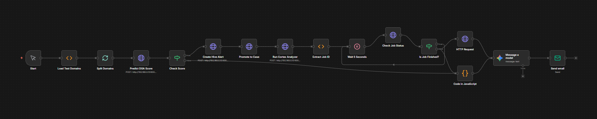

# DNS DGA Detection & Automated SOC Pipeline

An n8n-based automation workflow that detects **Domain Generation Algorithm (DGA)** domains using a machine learning API and automatically triggers a full SOC investigation pipeline — from alert creation to AI-assisted reporting.

---

## Table of Contents

- [Overview](#overview)
- [How DGA Detection Works](#how-dga-detection-works)
- [Workflow Architecture](#workflow-architecture)
- [Node-by-Node Breakdown](#node-by-node-breakdown)
- [System Components](#system-components)
- [Example SOC Report](#example-soc-report)
- [Example Cortex Report](#example-cortex-report)
- [Setup & Import](#setup--import)
- [Configuration](#configuration)
- [Repository Structure](#repository-structure)
- [Future Enhancements](#future-enhancements)

---

## Overview

Modern malware families use **Domain Generation Algorithms (DGAs)** to programmatically produce large numbers of random-looking domains, such as:

```
ajd92hsjkdqw.biz
mnsf82hdsak.ru
glbtlxwwhbnpxs.ru
```

These domains serve as Command-and-Control (C2) rendezvous points and are specifically designed to evade static blocklists through constant rotation. Because they appear random and change frequently, they are difficult to detect with traditional signature-based tools.

This project solves that with an **end-to-end automated detection and enrichment pipeline**:

1. Domains are scored by an ML API
2. Suspicious domains trigger TheHive alerts and cases
3. Cortex runs VirusTotal analysis
4. WHOIS and DNS data is enriched in parallel
5. Gemini AI generates a human-readable SOC report
6. The report is emailed to the analyst

---

## How DGA Detection Works

Each domain is sent to a local ML API (`POST /predict`) which returns a `probability_DGA` score between 0 and 1.

| Score | Classification |
|-------|---------------|
| `< 0.6` | Benign — WHOIS/DNS enrichment only |
| `0.6 – 0.69` | Suspicious — Severity 1 (Low) |
| `0.70 – 0.79` | Suspicious — Severity 2 (Medium) |
| `≥ 0.8` | Suspicious — Severity 3 (High) |

Domains that score **≥ 0.6** enter the full SOC pipeline. Domains below the threshold still receive WHOIS/DNS enrichment and are included in the final merged report.

---

## Workflow Architecture

```
Start
  └─> Load Test Domains (31 domains)
        └─> Split in Batches (size: 4)
              └─> Predict DGA Score (ML API POST /predict)
                    └─> Check Score (≥ 0.6?)
                          │
                          ├─ YES (suspicious)
                          │     └─> Create Hive Alert (severity from score)
                          │           └─> Promote to Case
                          │                 └─> Run Cortex VirusTotal Analyzer
                          │                       └─> Extract Job ID
                          │                             └─> Wait → Check Job Status ─┐
                          │                                         ↑                 │ (loop until Success)
                          │                                         └─────────────────┘
                          │                                   │ (Success)
                          │                             ┌─────┴──────────────────┐
                          │                             │                        │
                          │                    Fetch Cortex Report      WHOIS enrichment
                          │                    (HTTP Request)           (DGA domains)
                          │                             └─────┬──────────────────┘
                          │                                   │
                          └─ NO (benign)                      │
                                └─> WHOIS/DNS enrichment ─────┘
                                    (non-DGA domains)          │
                                                          Merge (3 inputs)
                                                               │
                                                    Gemini AI Summarization
                                                               │
                                                         Send Email (SMTP)
```

---

## Node-by-Node Breakdown

| # | Node | Type | Description |
|---|------|------|-------------|
| 1 | **Start** | Manual Trigger | Kicks off the workflow manually |
| 2 | **Load Test Domains** | Function | Loads 31 test domains (mix of DGA and legitimate) |
| 3 | **Split Domains** | Split in Batches | Processes domains in batches of 4 |
| 4 | **Predict DGA Score** | HTTP Request | `POST http://<ML-API>:8000/predict` with `{ domain }` |
| 5 | **Check Score** | IF | Branches on `probability_DGA >= 0.6` |
| 6 | **Create Hive Alert** | HTTP Request | Creates an alert in TheHive with severity derived from the score |
| 7 | **Promote to Case** | HTTP Request | Promotes the TheHive alert to a full investigation case |
| 8 | **Run Cortex Analyzer** | HTTP Request | Submits the domain to the Cortex VirusTotal analyzer |
| 9 | **Extract Job ID** | Function | Extracts the Cortex job ID for polling |
| 10 | **Wait 5 Seconds** | Wait | Pauses before polling Cortex job status |
| 11 | **Check Job Status** | HTTP Request | Polls `GET /api/job/{jobId}` on Cortex |
| 12 | **Is Job Finished?** | IF | Loops back to Wait if status ≠ `Success` |
| 13 | **HTTP Request** | HTTP Request | Fetches the full Cortex job report |
| 14 | **WHOIS enrichment (DGA)** | Code | WHOIS lookup via API-Ninjas for suspicious domains |
| 15 | **WHOIS enrichment (non-DGA)** | Code | WHOIS + DNS (A/NS/MX/TXT via Google DNS) for benign domains |
| 16 | **Merge** | Merge | Combines all 3 branches (Cortex report, DGA WHOIS, benign WHOIS) |
| 17 | **Gemini AI Summarization** | Google Gemini | Generates structured SOC report using `gemini-2.5-flash` |
| 18 | **Send Email** | Email Send | Delivers the AI-generated report via SMTP |

---

## System Components

| Component | Role |
|-----------|------|
| **n8n** | Workflow automation engine |
| **ML API** | Local DGA probability classifier (`/predict` endpoint) |
| **TheHive** | Alert and case management (SIEM/SOAR) |
| **Cortex** | Automated analysis engine |
| **VirusTotal Analyzer** | Domain reputation lookup (via Cortex) |
| **API-Ninjas WHOIS** | Domain registration data enrichment |
| **Google DNS** | Passive DNS resolution (A, NS, MX, TXT records) |
| **Google Gemini** | AI-assisted SOC report generation (`gemini-2.5-flash`) |
| **SMTP** | Email delivery to SOC analyst |

---

## Example SOC Report

The Gemini AI node produces structured reports like the following:

**Benign domain:**
```
Indicator: hlsgafabsduw.ru
Risk Level: Safe
Detection Ratio: 0/90
Verdict: No malicious activity detected
Recommendation: Continue monitoring
```

**Suspicious domain:**
```
Indicator: yfcjwloujkcmil.biz
Risk Level: Suspicious
Detected URLs: 1/90 engines
Verdict: May be associated with malicious behavior
Recommendation: Block and investigate further
```

---

## Example Cortex Report

```json
{
  "summary": {
    "taxonomies": [
      {
        "predicate": "GetReport",
        "namespace": "VT",
        "value": "1 detected_url(s)",
        "level": "suspicious"
      }
    ]
  },
  "full": {
    "detected_urls": [
      {
        "total": 90,
        "positives": 1,
        "scan_date": "2023-07-23 23:20:17",
        "url": "https://yfcjwloujkcmil.biz/"
      }
    ]
  },
  "success": true
}
```

---

## Setup & Import

### Prerequisites

- n8n instance (self-hosted or cloud)
- Local ML API running on port `8000` with a `POST /predict` endpoint returning `{ "probability_DGA": <float> }`
- TheHive instance accessible at `http://thehive`
- Cortex instance accessible at `http://cortex` with the VirusTotal analyzer enabled
- API-Ninjas account for WHOIS lookups
- Google Gemini API key
- SMTP credentials

### Importing the Workflow

1. Open your n8n instance and go to **Workflows**.
2. Click **Import from file**.
3. Select `n8n-workflow.json` from this repository.
4. The workflow will be imported with all nodes and connections intact.

### Credentials to Configure

After importing, update the following credentials in n8n:

| Node | Credential | Where to get it |
|------|-----------|-----------------|
| Create Hive Alert, Promote to Case | TheHive API key | TheHive → Admin → API Keys |
| Run Cortex Analyzer, Check Job Status, HTTP Request (report) | Cortex API key | Cortex → Admin → API Keys |
| WHOIS enrichment nodes | API-Ninjas API key | [api-ninjas.com](https://api-ninjas.com) |
| Gemini AI Summarization | Google Gemini API key | [Google AI Studio](https://aistudio.google.com) |
| Send Email | SMTP credentials | Your email provider settings |

### URL Configuration

Update the following URLs inside the workflow nodes to match your environment:

| Node | URL to update |
|------|--------------|
| Predict DGA Score | `http://192.168.0.13:8000/predict` → your ML API address |
| Create Hive Alert | `http://thehive/api/alert` → your TheHive address |
| Promote to Case | `http://thehive/api/alert/{id}/createCase` |
| Run Cortex Analyzer | `http://cortex/api/analyzer/{id}/run` → your Cortex address + analyzer ID |
| Check Job Status | `http://cortex/api/job/{jobId}` |
| HTTP Request (report) | `http://cortex:9001/api/job/{id}/report` |

---

## Repository Structure

```
DGA-detection-workflow/
├── n8n-workflow.json    # Importable n8n workflow definition
├── image.png            # Workflow diagram / screenshot
└── README.md
```

---

## Future Enhancements

- Scheduled/automated domain feed ingestion (replace manual trigger)
- Multi-source threat intel (Shodan, AbuseIPDB, PassiveTotal)
- Dashboard and visual analytics for DGA trends
- DNS sinkhole integration
- Slack/Teams notification support alongside email
- Adjustable DGA threshold via workflow input parameter
